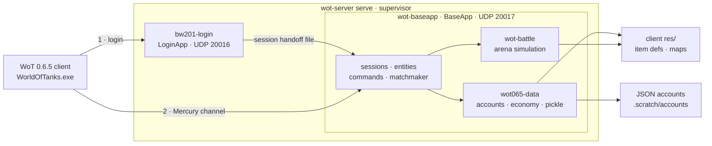
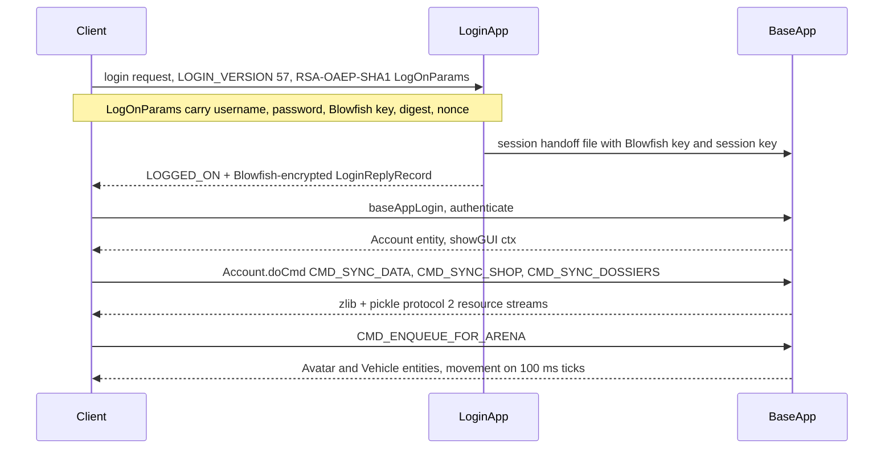

# interstellar

**A from-scratch Rust server for the retail World of Tanks 0.6.5 client (2011, BigWorld Engine 2.0.1).**


The retail 0.6.5 client logs in to this server, opens a working hangar with every vehicle
from the game files, and plays battles against bots or other players. No client code is
modified. Only two data files change: `res/scripts_config.xml` (the login address) and
`res/loginapp_wot.pubkey` (the RSA key). `setup` backs both up, and `restore-client` puts them
back.

- **Written from scratch in Rust.** No Wargaming or BigWorld server binaries are involved. The
  wire protocol, entity contracts and payloads were reconstructed from the public BigWorld
  2.0.1 source and the behaviour of the 0.6.5 client.
- **No Python at runtime.** The client expects Python 2.6 `cPickle` payloads. A Rust encoder
  produces them.
- **Game data comes from your client.** Vehicles, items, terrain, collision geometry and maps
  load straight from the client's `res/` folder: packed XML, `.cdata`, `.chunk`, BSP.
- **Persistent offline accounts.** Profiles are JSON files that a CLI can inspect and edit.

**Contents:** [What works](#what-works) · [Quick start](#quick-start) ·
[Running the server](#running-the-server) · [How it works](#how-it-works) ·
[Repository layout](#repository-layout) · [Development](#development) ·
[Troubleshooting](#troubleshooting) · [Documentation](#documentation) ·
[Security](#security) · [Legal and license](#legal-and-license)

## What works

| Area | What you get | Checked by |
|---|---|---|
| Client deployment | `setup` points the client at your server and installs your key. `restore-client` undoes it. | live client |
| Login | BigWorld 2.0.1 LoginApp over UDP: RSA-OAEP-SHA1 `LogOnParams`, Blowfish session key, session handoff to the BaseApp | unit tests, E2E UDP tests, [live client capture](docs/research/login-request-capture.md) |
| Hangar | All 130 vehicles of 0.6.5 (USSR 45, Germany 44, USA 41). Buying and selling, research and unlocks, modules, ammunition, equipment, crew, gold exchange, dossiers. | unit tests, E2E UDP tests, headless client |
| Battle entry | Random battles with a matchmaker that fills empty slots with bots, and training rooms | unit tests, headless client (Random) |
| Battle | 50 ms fixed-step simulation: driving physics on real terrain, collisions and ramming, ballistics and armour penetration, module and crew damage, fires, consumables, destructible objects, spotting and camouflage, base capture, bot AI | unit tests, headless client, live client ([ADR 0002](docs/adr/0002-hull-footprint-collisions.md), [0003](docs/adr/0003-whole-update-ticks.md)) |
| After battle | Battle chat, results, XP and credits, repairs and resupply, dossier updates | unit tests, headless client (results, dossier) |

This is a research project. Behaviour follows the decompiled 0.6.5 client contract, so expect
some differences from the 2011 live servers.

## Quick start

### Requirements

- **Windows.** The 0.6.5 client is a Windows DirectX 9 game. The server is developed and tested
  on Windows too.
- **Rust**, stable toolchain via [rustup](https://rustup.rs) (edition 2021).
- **Your own copy of the World of Tanks 0.6.5 client.** It is not included in this repository.

### Build, deploy, play

Clone the repository, then run these commands in PowerShell from its root folder:

```powershell
# Your 0.6.5 install: the folder that contains res\ and WorldOfTanks.exe
$game = "<path to your World of Tanks 0.6.5 folder>"

# 1. Build every binary: wot-server, bw201-login, wot-baseapp, wot065-data, wot-client-emulator
cargo build --release --workspace

# 2. Create an RSA key pair, point the client at 127.0.0.1:20016, install the public key
.\target\release\wot-server.exe setup --game-dir $game --keys-dir .scratch/wot-keys

# 3. Start the LoginApp (UDP 20016) and the BaseApp (UDP 20017). Ctrl+C stops both.
.\target\release\wot-server.exe serve --game-dir $game
```

Then start `WorldOfTanks.exe` from `$game`, enter any email and password, and press
**Connect**. The first login creates the account.

> [!NOTE]
> `setup` and `keys` write keys to `keys/` by default, while `serve` reads
> `.scratch/wot-keys/loginapp_priv.pem` by default. Pass `--keys-dir .scratch/wot-keys` as above,
> or point `serve --priv-key` at your key. Both folders are git-ignored.

### Check or undo the client changes

```powershell
# Show the client's login address and compare its installed key with yours
.\target\release\wot-server.exe check-client --game-dir $game --pubkey .scratch/wot-keys/loginapp_pub.pem

# Put the original scripts_config.xml and loginapp_wot.pubkey back from their .orig backups
.\target\release\wot-server.exe restore-client --game-dir $game
```

`keys` only creates the key pair. `patch-client --pubkey <pem>` only patches the client, using
a key pair you already have.

## Running the server

`serve` is a supervisor. It starts `bw201-login` and `wot-baseapp` from the folder that
contains `wot-server.exe`, and writes their logs to `--log-dir`.

| Flag | Default | Meaning |
|---|---|---|
| `--game-dir` | required | 0.6.5 install. Vehicles, maps and entity definitions load from it. |
| `--preset` | `retail` | Starting profile for new accounts: `retail` or `sandbox` |
| `--data-dir` | `.scratch/accounts` | JSON account profiles |
| `--log-dir` | `.scratch/logs` | Child process logs and the login session handoff file |
| `--priv-key` | `.scratch/wot-keys/loginapp_priv.pem` | RSA key that decrypts login requests |
| `--login-bind` | `127.0.0.1:20016` | LoginApp address |
| `--base-bind` | `127.0.0.1:20017` | BaseApp address. The LoginApp hands it to the client. |
| `--team-size` | `7` | Vehicles per team in Random battles (1–15) |
| `--queue-wait-secs` | `5` | How long the queue waits for other players before it adds bots |
| `--prebattle-countdown-secs` | `30` | Countdown after the last client is ready |
| `--dev-features` | off | Developer battle commands. `--preset sandbox` turns them on too. |
| `--economics-config` | none | JSON file with custom prices and rewards |
| `--battle-config` | none | JSON file that overrides battle balance |

`wot-server serve --help` lists every flag.

### Account presets

| Preset | Credits | Gold | Free XP | Extras |
|---|---:|---:|---:|---|
| `retail` | 10,000 | 0 | 0 | 6 garage slots, 16 barracks berths |
| `sandbox` | 50,000,000 | 1,000,000 | 5,000,000 | Vehicle and crew XP to spend, developer battle commands |

These are the built-in defaults. `--economics-config` replaces them.

### Offline accounts

Account names are case-insensitive. Stop `serve` before you edit an account: the running BaseApp
keeps accounts in memory and does not reload the JSON files.

```powershell
$login = "<the login you typed in the client>"

.\target\release\wot-server.exe account show $login
.\target\release\wot-server.exe account grant $login --credits 1000000 --gold 5000 --free-xp 100000 --game-dir $game
.\target\release\wot-server.exe account grant $login --unlock-all --game-dir $game
.\target\release\wot-server.exe account damage $login --all --hp-fraction 0.3 --game-dir $game
.\target\release\wot-server.exe account reset $login --preset sandbox --game-dir $game
```

`grant` also takes `--veh-xp <NATION:NAME>=<XP>` and `--tman-xp <TANKMAN_ID>=<XP>`, and both
can repeat. `reset`, `grant` and `damage` read item definitions, so always pass `--game-dir`.

## How it works

The client speaks BigWorld's Mercury protocol over two UDP endpoints. `wot-server serve` runs
both server sides. The battle simulation and the account logic are libraries inside the BaseApp
process.



A session, from login to battle:



The parts that are easy to get wrong:

- **Login.** The LoginApp writes the session handoff before it answers `LOGGED_ON`. If the
  write fails, it rejects the login as "server not ready" rather than sending the client to a
  BaseApp that cannot know it. The decoded request is in
  [`docs/research/login-request-capture.md`](docs/research/login-request-capture.md).
- **Hangar data** is not sent as entity properties. It travels as zlib-compressed Python 2
  pickles in resource streams, with one 15-byte compact descriptor per vehicle. The client
  only fills its shop cache from the stream path.
- **Battles.** `wot-battle` advances arenas in fixed 50 ms steps, and the BaseApp sends state on
  whole 100 ms update ticks. Tanks collide with a hull footprint rectangle, not a circle. See
  [ADR 0001](docs/adr/0001-fixed-step-battle-simulation.md),
  [0002](docs/adr/0002-hull-footprint-collisions.md) and
  [0003](docs/adr/0003-whole-update-ticks.md).

## Repository layout

| Path | Role |
|---|---|
| [`src/`](src/) | `wot-server` CLI: client deployment, supervisor, account tool |
| [`crates/bw201`](crates/bw201/) | BigWorld 2.0.1 transport: BinaryStream, Mercury packets and bundles, RSA and Blowfish, the `bw201-login` LoginApp |
| [`crates/wot-baseapp`](crates/wot-baseapp/) | BaseApp: sessions, Account and Avatar entities, command dispatch, matchmaking |
| [`crates/wot065-data`](crates/wot065-data/) | Vehicle catalog, compact descriptors, account engine and economy, Python 2 pickle codec, atomic JSON store |
| [`crates/wot-battle`](crates/wot-battle/) | Map loaders (terrain, chunks, BSP, destructibles), physics, ballistics, damage, visibility, bot navigation |
| [`crates/wot-client-emulator`](crates/wot-client-emulator/) | Headless 0.6.5 client for automated checks |
| [`vendor/wg-toolkit-rs`](vendor/wg-toolkit-rs/) | Vendored upstream toolkit, used for the packed XML codec. Excluded from the workspace. |
| [`tools/`](tools/) | Python and PowerShell research helpers: UDP logger, packet decoder, login prototype |
| [`docs/`](docs/) | ADRs, protocol research, design specs and plans |
| [`wiki/`](wiki/), [`raw/`](raw/) | Knowledge base that an LLM agent maintains (Obsidian vault), and its source documents |

## Development

```powershell
cargo check --workspace
cargo test --workspace
```

- **Tests that need the retail client** return early when they cannot find it, so a machine
  without the game still runs the rest. `wot065-data` looks in `WOT065_GAME_DIR` first. A few
  integration tests still probe one fixed developer path.
- **`live_daemon_udp_smoke` is `#[ignore]`.** It needs a running server on `127.0.0.1:20016`
  and `127.0.0.1:20017`, and it reads the client's public key from that fixed developer path:

  ```powershell
  cargo test -p wot-baseapp live_daemon_udp_smoke -- --ignored
  ```

- **Rebuilding while the server runs fails**, because Windows locks a running `.exe`. Stop
  `serve` first.

### Headless client

`wot-client-emulator` logs in over UDP like the real client, checks what the server sends back,
and exits with a non-zero code when a check fails. It needs a running `serve`.

```powershell
# LoginApp, BaseApp, Account sync, shop, dossiers, server stats: five runs
.\target\release\wot-client-emulator.exe --game-dir $game hangar --repeat 5

# Random battle on map 3: drive, shoot, stay for the results, check the dossier
.\target\release\wot-client-emulator.exe --game-dir $game battle --map 3 --wait-for-results --timeout 1200

# Scripted JSON scenario with a JSON report
.\target\release\wot-client-emulator.exe --game-dir $game scenario crates/wot-client-emulator/examples/hangar.json --json
```

Each run creates a fresh test account. `--username` reuses one. Steps and assertions are
documented in the [emulator guide](crates/wot-client-emulator/README.md), which is in
Ukrainian.

### Game data CLI

```powershell
.\target\release\wot065-data.exe count --game-dir $game   # vehicle catalog: 130 types
```

The same binary dumps the catalog and every hangar payload. See the
[`wot065-data` guide](crates/wot065-data/README.md).

## Troubleshooting

| Symptom | Fix |
|---|---|
| `bw201-login binary not found` | Build with `cargo build --release --workspace`. Plain `cargo build` builds only `wot-server`. |
| `RSA private key not found at .scratch/wot-keys/loginapp_priv.pem` | Run `setup` with `--keys-dir .scratch/wot-keys`, or pass `serve --priv-key`. |
| The client cannot log in | Run `check-client --pubkey` with your public key. If the keys differ, run `patch-client --pubkey <pem>` again. |
| Login rejected as "server not ready" | The LoginApp could not write the session handoff. Make sure `--log-dir` is writable. |
| The hangar hangs while loading | Read `python.log` in the game folder, then `.scratch/logs/bw201-login.err.log` and `.scratch/logs/wot-baseapp.err.log`. |
| `Access is denied (os error 5)` on build | A running server locks its `.exe` under `target/`. Stop it with Ctrl+C. |
| `Access is denied (os error 5)` at runtime | The checkout may carry a Low integrity label, and Low-IL processes cannot write to `%TEMP%`. Keep runtime files inside the repo. The defaults (`.scratch/`, `--log-dir`) already do. |
| Account edits do not show up | Stop `serve` before `wot-server account ...`, then start it again. |

## Documentation

- [`docs/adr/`](docs/adr/): architecture decisions, in Ukrainian.
- [`GLOSSARY.md`](GLOSSARY.md): domain vocabulary, in Ukrainian.
- [`docs/research/`](docs/research/): protocol research.
  - [`bw201-login-wire.md`](docs/research/bw201-login-wire.md)
  - [`bw201-baseapp-wire.md`](docs/research/bw201-baseapp-wire.md)
  - [`client-analysis.md`](docs/research/client-analysis.md)
  - [`protocol-scout.md`](docs/research/protocol-scout.md)
  - [`login-request-capture.md`](docs/research/login-request-capture.md)
- [`docs/superpowers/specs/`](docs/superpowers/specs/) and
  [`docs/superpowers/plans/`](docs/superpowers/plans/): design specs and implementation
  plans for the hangar and the battle system.
- [`wiki/`](wiki/): knowledge base that an LLM agent maintains, in Ukrainian. Start at
  [`wiki/index.md`](wiki/index.md) and [`wiki/overview.md`](wiki/overview.md).
- [`AGENTS.md`](AGENTS.md): rules for AI coding agents in this repo, covering build commands,
  Windows constraints and the wiki workflow.

## Security

> [!WARNING]
> This is a local development server, not a public game server.

- **Passwords are not checked.** Any login opens or creates the account with that name.
- **Network protection** is only the 2011 client's own RSA and Blowfish scheme.
- **Both apps bind to `127.0.0.1` by default.** Use them on a trusted LAN at most. Never forward
  the ports to the internet.
- **Keep the private key out of git.** `keys/` and `.scratch/wot-keys/` are git-ignored. Keep it
  that way.

## Legal and license

- World of Tanks is a trademark of Wargaming.net. This project is not affiliated with or
  endorsed by Wargaming.
- The game client is not included. You need your own copy of the 0.6.5 client. The server reads
  game data from it at runtime.
- Protocol layouts are derived from the publicly available BigWorld Engine 2.0.1 source, used as
  a reference, and from the behaviour of the 0.6.5 client. This is a non-commercial preservation
  and research project.
- **No license has been chosen for this project yet,** so default copyright applies.
  `vendor/wg-toolkit-rs` is MIT-licensed, © 2022 Théo Rozier
  ([license](vendor/wg-toolkit-rs/LICENSE)).
